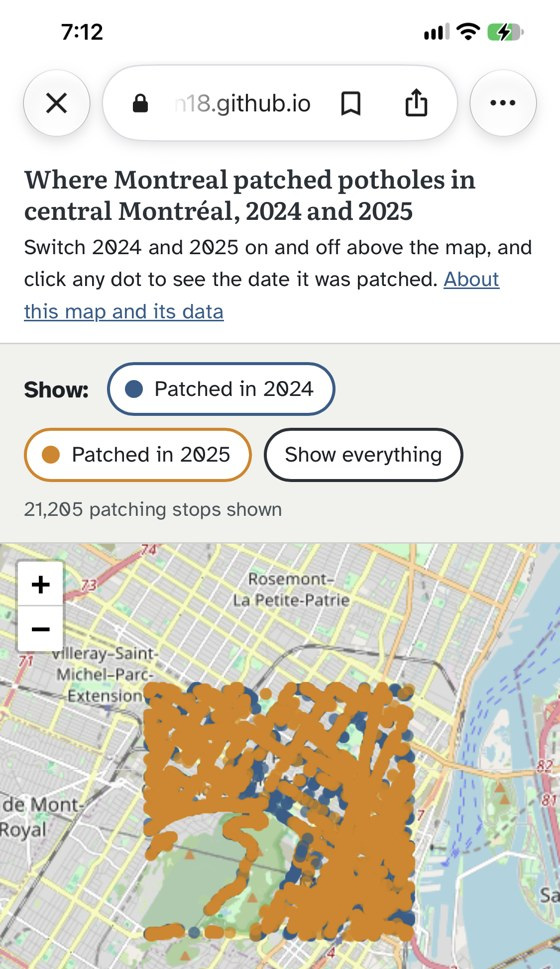
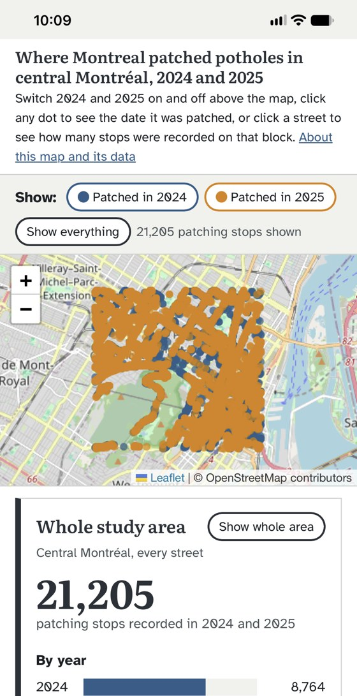

## Live link: 
https://fzaman18.github.io/montreal_potholes/site/

# Montreal pothole patches: central Montréal, 2024 and 2025 (after the MVP Demo)
 
GEOG 464 Programming for Geospatial Technologies, Fall 2026. A3: one feature, live, tested. Fariha Zaman.
 
Live map: the link above (opens the map page; the About page is `site/about.html`). Repository: https://github.com/fzaman18/montreal_potholes
 
A map of 21,205 pothole-patching stops made by Montreal's central road crews in central Montréal, with switches for 2024 and 2025, a dashboard of counts by year and by month, and, new in A3, a street click that shows the counts for one street segment. The site has two pages: the map (`site/index.html`) and About (`site/about.html`), which holds the written content and the data notes.
 
## The five sentences
 
1. **Problem.** Drivers and cyclists in central Montréal cannot easily see where the city's crews have patched potholes, how that changed between 2024 and 2025, or how many stops were recorded on a given street.
2. **Audience.** A Montreal driver or cyclist planning a route through central Montréal.
3. **Core action.** Switch 2024 and 2025 on and off, click any dot to see the date it was patched, and (new in A3) click a street to see how many stops were recorded on it, by year and by month.
4. **Boundary.** It does not rank streets, show live potholes, or take new pothole reports.
5. **Data.** The City of Montréal's records of mechanized pothole patching (GPS position and date), 2024 and 2025, and (new in A3) the city's street network (Géobase), used to count stops per street segment.
## A3 feature: Click a street
 
For A3 I will add street-level counts using the city's street network (Géobase), so that my reader can click any street segment and see its name and how many patching stops the city logged on it, by year and by month.
It has depth because it brings in a second dataset joined to the first (each stop is matched to its nearest street segment in Python), computes counts per segment, and responds to every click.
I will know it works when the numbers on the page match my Python check for the same segment. My edge case is a street where nothing was patched.

## My three test plans: 
 
**Test 1.** I click the block of De Maisonneuve Ouest in front of Concordia's Hall Building.
**Expected**: only that segment is highlighted. The panel shows the street name, with the segment's ID number in small print. The big number is the stops matched to that segment. The 2024 and 2025 bars add up to it, and so do the monthly bars. My Python check gives the same total for that segment ID.
**Result**: failed on the first run. The dashboard showed 0 stop for that block. The block of De Maisonneuve Ouest in front of the Hall Building has almost no patching stops, so there was no normal case to check. The page behaved correctly. The fault was in my test: I chose a block without checking that it had stops. I changed the street.
 
**Test 1 (revised).** I click Rue Mackay between Rue Sherbrooke Ouest and Boulevard De Maisonneuve Ouest.
**Expected**: only that segment is highlighted. The panel shows the street name, with the segment's ID number in small print. The big number is the stops matched to that segment. The 2024 and 2025 bars add up to it, and so do the monthly bars. My Python check gives the same total for that segment ID.
**Result**: passed. The page showed Rue Mackay, segment 1260403, with 23 stops (11 in 2024, 12 in 2025). The monthly bars add up (2024: 4 + 7 = 11; 2025: 8 + 2 + 2 = 12), and my Python check gave the same numbers.
 
**Test 2.** I click that segment, then a segment of a different street, then press "Show whole area".
**Expected**: after the second click only the new segment is highlighted, and every number and chart is for the new street. After the button, no segment is highlighted and the dashboard shows 21,205 stops (8,764 in 2024, 12,441 in 2025).
**Result**: passed. I clicked Rue Mackay, then De Maisonneuve Ouest. Only the second street stayed highlighted and every number changed. After "Show whole area" the highlight was gone and the dashboard showed 21,205 stops (8,764 in 2024, 12,441 in 2025).

**Test 3**. I click Avenue Maplewood.
**Expected**: that segment is highlighted and the big number says 0. A plain sentence says no stops were recorded on this street in 2024 or 2025, and that the file only covers central crews on main roads, so this does not mean the road is in good condition. The charts show as empty, not broken, and the console (the F12 error panel) shows no red errors.
**Result**: passed. I clicked Avenue Maplewood (segment 1604144). It was highlighted, the big number was 0, the sentence about main roads appeared, and the charts were empty rather than broken.  The red console lines I first saw came from browser extensions (zotero.js and inject.js), not from my files. The console showed no red errors on my live link.

## How the feature works

All line numbers are in `site/app.js`. The counting per street is done in Python (`notebooks/a3_streets.ipynb`) and saved in `data/streets_central.geojson`. The page only looks the numbers up.

- **The event, line 282.** `map.on("click", ...)` runs whenever the reader clicks the map.
- **The handler, lines 283 to 295.** It checks that the stop data and the street file have loaded (lines 283 to 287). It then turns 18 screen pixels into metres at the current zoom (`metresPerPixel`, lines 299 to 301) and keeps that between 10 m and 60 m (line 289), so the click only has to land near a street, about a fingertip away. `nearestStreet` (lines 304 to 318) measures from the click to every piece of every street segment, using `distToPiece` (lines 321 to 327), and keeps the closest one that is within reach. If none is, `showNoStreet` (lines 355 to 361) clears the old highlight and numbers and says so in bold.
- **The update, lines 330 to 344.** `chooseStreet` removes the old highlight (line 331), draws the chosen segment as a dark line (line 333), reads its counts (lines 335 to 339) and calls `renderDashboard` (line 343). `renderDashboard` (lines 162 to 173) redraws the big number, the yearly bars (`drawYears`, lines 176 to 198) and the monthly bars (`drawMonths`, lines 202 to 232). A month with no stops anywhere in the area shows "no records" instead of a zero.
- **The streets file, lines 269 to 279.** The same `fetch` pattern as the stops, pointed at `streets_central.geojson`. If it fails, the click handler says so (line 285) and the whole-area numbers still work.
- **The whole-area view, lines 149 to 159 and 241 to 244.** `countWholeArea` tallies each stop by year and month as the dots load. `showWholeArea` shows those totals, or "No data" if no stop was counted. `resetDashboard` (lines 254 to 258) is what "Show whole area" does: it removes the highlight, closes any popup and shows the whole area again.
**One thing I do not yet fully understand:** How to efficiently ingetrate patched pothole data for the entire Island of Montreal across multiple years without slowing down the web map, given the large number of data points involved.

## Usability test and my one fix (A3 Part 3)
 
On Wednesday 11 November I tested the live map with four people: two classmates one-on-one on their phones (about 20 minutes each), and two more in a rapid round on a laptop. The full findings table, with evidence and severity ratings, is in `A3_Part3_Zaman.docx`. In short:
 
| # | What I saw | Severity | What I did |
| --- | --- | --- | --- |
| 1 | Users 2, 3 and 4 took about 2 minutes to notice that a street can be clicked. | 2 | **Fixed (part 1 of the one fix).** |
| 2 | On a phone, User 1 took about 5 minutes and User 2 about 3 minutes to notice the dashboard below the map. | 2 | **Fixed (part 2 of the one fix).** |
| 3 | All four testers wanted a street search bar. | 2 | Later (A4). |
| 4 | Users 3 and 4 found the dots too small to click at maximum zoom. | 2 | Later. |
| 5 | All four testers asked for the dots to sit inside the streets and for the whole Island to be covered. | 2 | Later (A4). |
| 6 | Users 1, 2 and 4 never pressed "Show whole area". User 3 understood it at about 6 minutes. | 1 | Later (A4). |
 
What worked: when I asked for a first impression, all four testers said almost immediately that the map shows pothole patches in central Montréal over two years, for drivers or cyclists, and Users 1, 2 and 3 added that it could help residents raise concerns regarding street conditions with their borough and help city planners. Every tester found Rue Mackay (2 to 3 minutes), and the two testers who filled in the SUS gave scores of 75 and 90.
 
**My one fix.** Findings 1 and 2 are one problem: the reader cannot find the street counts. So my one fix has two parts that only work together. In Part H of my test plan I had already chosen a hint in the page header as my fix if testers missed the street click, and they did.
 
- **Part 1, the header (`site/index.html`, line 17).** Before: "Switch 2024 and 2025 on and off above the map, and click any dot to see the date it was patched." After: "Switch 2024 and 2025 on and off above the map, click any dot to see the date it was patched, or click a street to see how many stops were recorded on that block."
- **Part 2, the phone layout (`site/style.css`, lines 129 to 138, a new block at the end of the file).** On screens 860 px wide or less, the map is shorter (34% of the screen height, never under 220 px), and the header text, buttons and spacing are smaller. This replaces the 360 px minimum height that the map had on phones, so the heading and the big number of the dashboard now show under the map without scrolling.
I changed nothing else on the live map.
 
| Before (my iPhone, Wednesday) | After (my iPhone, after the fix) |
| --- | --- |
|  |  |
 
The brief asks for one improvement, so I held back the other findings (rows 3 to 6). They are my starting list for A4: a street search box, dots moved onto the streets, the whole Island, bigger dots, planning routes, a "Show whole area" button that zooms out, and "Show everything" renamed "Show all years" which does not reset the map to starting zoom.

## Pre-flight report:

Run on my live link (https://fzaman18.github.io/montreal_potholes/site/) in a private window, with the F12 tools open.
 
| Check | Result | What I did |
| --- | --- | --- |
| 1. Cold start | pass | Opened the live link in a private window with the console open and hard refreshed. The map, dots and dashboard (21,205) loaded and the console had no red lines. |
| 2. Read every label | pass | Read the text in a dot's popup, a street with stops, a street with no stops, a click in a green space and the whole-area view. No undefined, null, NaN or [object Object] anywhere. |
| 3. Ask twice | fault found, fixed | Pressing "Show whole area" reset the dashboard and the street highlight but left a clicked dot's popup open and the dot enlarged. Fixed by closing the popup in the reset function (commit "Close the dot popup when Show whole area is pressed (pre-flight check 3)"). Rechecked on the live link: the popup closes and the dot returns to normal size. Clicking a second street or a second dot already replaced the first answer. |
| 4. The edge | pass | Clicked a green space, zoomed out and clicked, clicked outside my area, and pressed "Show whole area" twice. Each gave a sentence (a bold "No street selected" message) or the whole-area view, with no red errors and no old answer left on screen. |
| 5. The data does not come | fault found, fixed | Blocking the stop data left the dashboard stuck on "..." with empty charts, and the page told readers to open the console. Fixed so the dashboard says "No data" with a bold message and the page says to check the connection and reload (commit "Tell the reader in words when the patch data does not load (pre-flight check 5)"). A second fault followed: pressing "Show whole area" while the data was missing replaced "No data" with a misleading 0. Fixed so the "No data" message stays (commit "Keep the No data message when Show whole area is pressed without data"). Rechecked on the live link. Blocking the streets file leaves the whole-area numbers working and gives a bold message when a street is clicked. |
| 6. On a phone (size view and my phone) | fault found, fixed | In the phone-size view (iPhone SE, 375 px) the dashboard sat below the page title, off screen, so tapping a street changed numbers the reader could not see. Fixed in commit "Put the dashboard under the map on phones (pre-flight check 6)". Rechecked in the phone-size view and on my iPhone: the dashboard sits directly under the map, the popup fits the screen, and nothing scrolls sideways. The page title then sat lower on phones, which the page split fixed: the title and one-line instructions now sit in a header above the map.
| 7. Mouse in my pocket | pass for the controls, known issue for the map | Tab reaches the year chips, Show everything, Show whole area, the map, and the data and licence links. Selecting a dot or a street needs a mouse or a finger, so keyboard users cannot reach the street counts. Next step: a street search box in A4. |
| 8. Accessibility audit | pass | Lighthouse Accessibility scored 100 on desktop and 100 on mobile, with no failing items to fix. |

 
**Known issues.** Dots and streets cannot be selected with the keyboard. "Show whole area" does not zoom the map back out (that is what "Show everything" does). The year chips switch the dots but not the dashboard, which always shows both years. Dots are drawn where the city's GPS put them, so some sit a few metres off the road.

## Pages, files and layers
 
| Layer | File | What it does |
| --- | --- | --- |
| Data | `data/potholes_2024_2025.geojson` | 21,205 patching stops in central Montréal, each with a date and a year (3.22 MB) |
| Data | `data/streets_central.geojson` | 3,237 street segments with their name, ID, road class and the number of stops matched to each, by year and month (1.41 MB) |
| Data | `data/remplissage_niddepoule_2024.gpkg`, `data/remplissage_niddepoule_2025.gpkg` | The city's patch records as downloaded, one file per year |
| Processing | `notebooks/mtl_potholes.ipynb` | A2: reads the two years, drops bad rows, converts metres to degrees, cuts to one area, writes the stops GeoJSON, then checks it |
| Processing | `notebooks/a3_streets.ipynb` | A3: clips the Géobase to the same area, matches each stop to its nearest street segment, counts per segment by year and month, writes and checks the streets GeoJSON |
| Structure | `site/index.html` | The map page: header, dashboard, year switches and map |
| Structure | `site/about.html` | The About page: who it is for, how to read it, what is not included, where the data comes from |
| Presentation | `site/style.css` | Colours taken from the subject: asphalt, steel blue for 2024, amber for 2025 |
| Behaviour | `site/app.js` | Draws the dots, builds the year switches, opens the popup, builds the dashboard and handles the street click |

## Running it
 
1. Opened the folder `montreal-potholes` in VS Code (the folder itself, not `site`).
2. The Géobase is too big for GitHub (41.1 MB), so it is not in the repository. Downloaded the GeoJSON from https://donnees.montreal.ca/dataset/geobase, saved it as `raw/geobase.json`, and ran `notebooks/a3_streets.ipynb` top to bottom. The last check cells print `PASS` lines and `All checks passed`.
3. Right-clicked `site/index.html` and choose Open with Live Server.

## Data sources (the receipts)
 
**Pothole stops**
 
| | |
| --- | --- |
| Title | Travaux de colmatage mécanisé de nid-de-poule des chaussées (earlier title: Réfection de chaussée par remplissage mécanisé de nid-de-poule) |
| Publisher | Ville de Montréal, Service des infrastructures du réseau routier |
| Link | https://donnees.montreal.ca/dataset/refection-de-chaussee-par-remplissage-mecanise-de-nid-de-poule |
| Licence | Attribution (CC BY 4.0): https://creativecommons.org/licenses/by/4.0/ |
| Date accessed | 2 October 2026 |
| Files used | `remplissage_niddepoule_2024.gpkg`, `remplissage_niddepoule_2025.gpkg` (GeoPackage, one per year) |
| Coordinates | Metres in EPSG:2950 (Montreal's MTM zone 8), converted to degrees (EPSG:4326) with GeoPandas |
| Coverage | 2024 runs from 17 January to 30 May 2024, with no stops in February. 2025 runs from 18 January to 20 May 2025. |
 
**Street network**
 
| | |
| --- | --- |
| Title | Géobase - réseau routier |
| Publisher | Ville de Montréal, Service des infrastructures du réseau routier, Division de la géomatique |
| Link | https://donnees.montreal.ca/dataset/geobase |
| Licence | Attribution (CC BY 4.0), the City of Montréal's open data licence: https://creativecommons.org/licenses/by/4.0/ |
| Date accessed | 10 November 2026 (the portal says it is updated weekly) |
| File used | `geobase.json` (GeoJSON, 41.1 MB, kept out of GitHub; link above) |
| Coordinates | Degrees (EPSG:4326); converted to EPSG:2950 for measuring distances |
 
### What the notebooks changed
 
Pothole stops (`mtl_potholes.ipynb`):
 
- Kept only the date, the year and the position of each stop, and dropped the vehicle column.
- Kept only the stops inside central Montréal, a box with south 45.495, north 45.535, west -73.615 and east -73.555 (degrees).
- Checked for rows with no location or no date (none were found), and removed rows dated outside 2024 and 2025, counting each removal.
- Combined 2024 and 2025 into one GeoJSON file with a `year` property.

Streets (`a3_streets.ipynb`):
 
- Clipped the Géobase to the same box (3,253 of 48,034 segments) and kept only the ID, the full street name, the road class and the shape. Trimmed the spaces at the end of street names.
- Left out tunnel segments (POSITION 7 to 9) when matching stops to streets, because a tunnel lies directly under a surface street and a stop could be matched to the wrong one. 159 of 21,205 stops (0.75%) had a tunnel as their nearest street (113 on Route 136, 46 on an unnamed way). They were matched to the nearest surface street instead, or left unmatched if none was within 30 m. That left 3,237 segments.
- Matched each stop to its nearest segment with `sjoin_nearest` (in metres, EPSG:2950, searching up to 100 m) and kept the match only if it was within 30 m.
- Counted the matched stops per segment, by year and by month, and wrote them as fields on the segment (`total`, `y2024`, `y2025` and `m24_1` to `m25_5`).

### Counts
 
| Step | Rows |
| --- | --- |
| Stops read (2024 and 2025 together) | 124,570 |
| Dropped: no location or no date | 0 |
| Dropped: dated outside 2024 and 2025 | 4 |
| Dropped: outside the central Montréal box | 103,361 |
| Kept (features in the stops GeoJSON) | 21,205 |
| Kept in 2024 / kept in 2025 | 8,764 / 12,441 |
| Stops matched to a street (within 30 m) | 20,931 (8,626 in 2024, 12,305 in 2025) |
| Stops not matched (farther than 30 m) | 274 |
| Segments in the streets GeoJSON | 3,237 |
| Segments with at least one stop / with none | 1,735 / 1,502 |
 
How far the stops are from their nearest street's centre line: 49.4% within 5 m, 78.4% within 10 m, 90.6% within 15 m, 95.2% within 20 m, 98.7% within 30 m, 99.9% within 50 m. The totals add up at every step: 20,931 matched + 274 not matched = 21,205 stops, and the segment counts add up to 20,931.

## What the data can and cannot show
 
From the city's own description of the data:
 
- It records only patches made by central road crews with mechanized equipment. Borough repairs and manual repairs are not included.
- Mechanized patching focuses on arterial (main) roads first, so a street with no dots may simply not be covered. In my area 1,502 of 3,237 segments have no stops.
- One GPS position can cover several potholes patched from the same spot.
- GPS accuracy is usually a few metres, but can be tens of metres near tall obstacles.
- These are raw data without corrections.
From my own checks:
 
- The two years do not cover the same months. In my area, 2024 has stops in January, March, April (only 41) and May but none in February, and 2025 has January to April but none in May. More dots for 2025 do not mean the city patched more that year.
- Matching a stop to a street does not move the dot. A dot can still sit beside the road or inside a building outline. Saving my file moved no point by more than 5.5 cm, so that is GPS error in the city's data, not my processing.
- Street counts say how many stops were matched to a segment, not how bad the road is.

## Not in this iteration

- **The whole city and the other years.** The city has published patch records since December 2016. This version shows one area and two years, so the files stay small enough to load quickly on a phone.
- **Ranking streets and repeat streets.** The page counts the stops on the segment you click, but does not rank streets or show which were patched in both years.
- **Street and borough search, and routes.** You can only reach a street by clicking the map.
- **Moving each dot onto its street.** Planned for A4.
- **Live data and new reports.** The file only records patches already made.
- **Severity, status and time of repair.** The data has only a vehicle, a date and time, and a position.

## Testing evidence
 
A2: the check cell reads the saved file back and prints "All checks passed". The row counts matched at every step. I switched each year on and off, clicked dots and read the date in the popup, and did the stranger test, during which we noticed dots inside buildings. I suspected my own rounding, so I measured how far saving moved the points (5.5 cm). I changed nothing, as the offset is likely GPS error.
 
A3: the three tests above (written and committed before any feature code, with Test 1 revised after it failed once), the segment check in `a3_streets.ipynb`, the `PASS` checks on the streets file, and the pre-flight report.

## AI disclosure (A3)
 
Lane: Green
Tool and model: Claude (chat window), Sonnet 5.5
 
- **What I asked it to do:** the Chat assistent helped me choose a feature; write the notebook (starting codes for a3_streets) steps one at a time for downloading and clipping the Géobase, matching stops to streets and counting per segment; write the JavaScript for the dashboard, the street click and the popup.
- **What came back, and what I did with it:** it first suggested a count within 250 m of a click. I chose the street feature using the Géobase instead, and I stayed with the central study box after seeing that the whole island would be about 35 to 45 MB. I asked why tunnels were removed (something I did not understand at first), so it ran a check (159 of 21,205 stops), and I kept the removal. My first Test 1 street had almost no stops, so the test failed; I recorded that and changed the street. I asked for the popup beside the dot, for "Show whole area" at the top of the dashboard and to close the popup, for the "no street" message to be bold and to clear the old numbers, and for the title to come first on phones. I ran the pre-flight checks myself and recorded the faults I found.
- **How I tested it:** the three tests written before the code, a Python check of one segment against the page, the totals checks in the notebook, the eight Lab 7 checks on the live link, and my iPhone.
- **A3 Part 3 (usability test and fix):** I ran the sessions and took the notes myself, and then used my notes to develope the findings table with severity ratings, and to draft this README update. I decided to make one key improvement: edit the header sentence to include the line about clicking a street to see how many stops were recorded for that block/street segment; and change the phone layout in style.css with the help of chat assistant, which fixed the problem. All other changes will come later (A4).
- **What stayed mine:** the topic, the area and years, the decision to add the Géobase, which streets to test, whether each test passed or failed, the testing itself, which fix to make, and all the writting of the pages and this README.

## After the demo
 
At my MVP demo, a classmate questioned whether the data is accurate enough, because many dots sit inside buildings instead of on roads. I measured that saving my file moves each dot by at most 5.5 cm, so I concluded it is most likely GPS error in the city's data, but I could not prove it.
For A3 I added the city's street network (Géobase) as a second dataset, so that I could match each stop to its nearest street and show counts per street. I did not move the dots onto the streets; that is planned for A4. The page says that dots are drawn where the city's GPS put them.
 
## Sources
 
- City of Montréal, Travaux de colmatage mécanisé de nid-de-poule des chaussées: https://donnees.montreal.ca/dataset/refection-de-chaussee-par-remplissage-mecanise-de-nid-de-poule
- City of Montréal, Géobase, réseau routier: https://donnees.montreal.ca/dataset/geobase
- Basemap: © OpenStreetMap contributors.
Data used under the Creative Commons Attribution 4.0 licence (CC BY 4.0), credited to Ville de Montréal. My changes are listed under "What the notebooks changed".